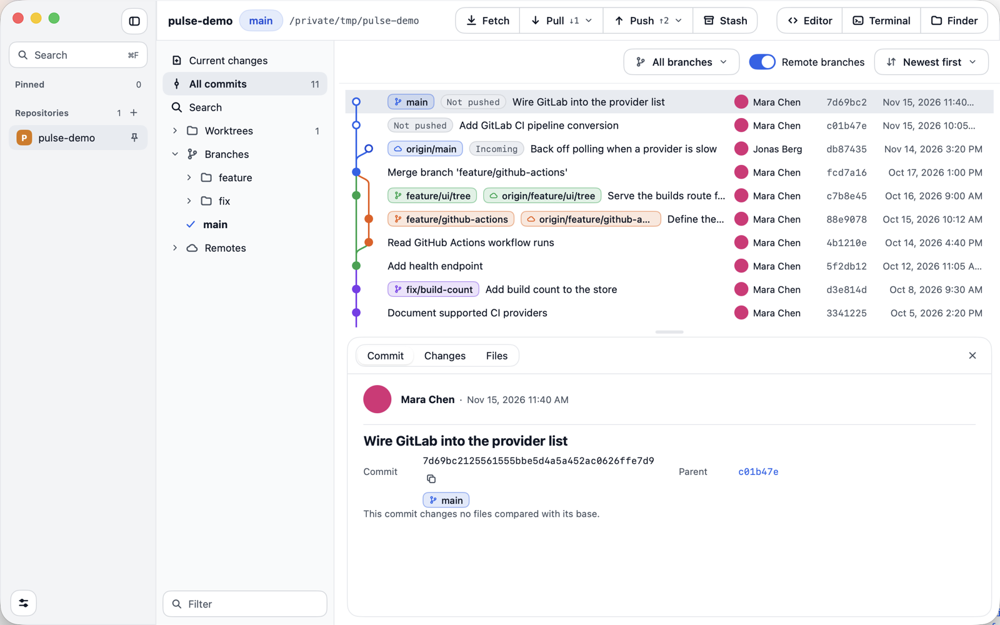

<p align="center">
  
</p>

# GitOwl

A lightweight macOS Git client for reviewing working tree changes and
history, managing branches and writing commit messages.




GitOwl is a native macOS app written in Go with
[MyGo](https://mygo.egoist.dev/). It has no web view; see
[ADR 0001](docs/adr/0001-mygo-native-ui-and-onevra.md) and
[ADR 0002](docs/adr/0002-mygo-native-ui-without-onevra.md) for the decisions behind it.

## Features

- **Current changes**: review file diffs, stage and unstage files or single
  hunks, stage or unstage everything, discard unstaged changes, and commit
  with a message. Commit and push, and amend the last commit, are in the same
  panel.
- **All commits**: browse history with a graph and search commit messages,
  authors, hashes and paths. Read each commit's files and diffs, check out a
  commit, revert, cherry-pick or mixed-reset from its menu.
- **Branches**: browse local and remote branches, create, switch and delete
  them, and merge or rebase from a branch's menu.
- **Worktrees**: list, open, create, remove and prune linked worktrees.
- **Tags**: create a tag on a branch or commit, push it to a remote, and
  delete it locally or on its remote.
- **Stash**: stash all changes, apply, pop, drop, rename, compare, or start a
  new branch from a stash.
- **Remote sync**: fetch, pull (merge, rebase or fast-forward only), push, and
  publish a new branch to its remote.
- **AI commit drafts**: generate a commit message from staged changes with any
  OpenAI-compatible service, including one running on your Mac. Settings
  → AI Drafts configures it.
- **Open in**: open a worktree or file in your editor, in Terminal or in Finder.

## Install

GitOwl is not signed with a Developer ID yet, so build it locally:

```sh
./scripts/build-macos.sh
open "dist/darwin-arm64/GitOwl 1.0.0 arm64.dmg"
```

Drag GitOwl to Applications. On first launch macOS may refuse to open it;
see [Signing and notarization](#signing-and-notarization).

## Usage

**Open a repository.** Open **Open Repository…** (⌘O), drop a folder on the
welcome screen, or pass its path on the command line:
`GitOwl.app/Contents/MacOS/GitOwl ~/src/project`. The welcome screen lists the
last 10 repositories (⇧⌘O searches them). Closing a repository (⇧⌘W) keeps its
changes and staging area as they are. GitOwl never reopens a repository by
itself.

**Review and commit.** Select a file to see its diff, then tick its check box
to stage it. In a diff, the hunk bar stages or unstages one hunk. **Discard
Unstaged Changes…** restores a file to its staged version after a confirmation
that names the file. **Commit** stays disabled, with the reason shown below
the message, until something is staged and the message is not blank. It
commits only the staged files.

**Browse history.** **All commits** opens on the newest commit. Select another
commit for its message, files and diffs. Choosing a branch only browses it:
nothing is checked out or fetched. The search looks through the history of
HEAD, a local branch or a remote branch, for text in messages, authors and
emails, for a commit hash of 4 to 64 hexadecimal digits, or for a file or folder path.

**Branches and worktrees.** Branches are listed in the left column as folders
for the parts of names such as `feature/ui/tree`, with remote branches below
them (read only). Double-click a branch or press Return to switch to it. The
**…** menu on a branch offers switch, delete (after confirmation) and the merge
or rebase actions. **New Worktree…** checks out a branch in a new folder beside
the main worktree. **Remove…** deletes a clean linked worktree and keeps its
branch. Each worktree keeps its own commit message, selection and scroll
position while you are elsewhere.

**Sync.** **Fetch** updates remote branches from the current branch's upstream
remote. It never changes files, the index or local branches, can be cancelled
and gives up after 2 minutes. **Pull** (`↓N`) brings in the upstream. Its
popover chooses Merge (the default, with local changes stashed around it),
Rebase, or Fast-forward only. **Push** (`↑N`) sends the current branch to its
upstream without tags. Its popover can also force-with-lease. A branch without
an upstream shows **Publish Branch…**. GitOwl uses your Git credential helper
and SSH agent and never shows
a password or host key prompt, so sign in or accept a new host with `git` or
`ssh` in Terminal once.

**AI drafts.** Open **Settings → AI Drafts** and enter an OpenAI-compatible
service URL, model and API key (the key is optional for a local service such
as `http://localhost:11434/v1`). Stage files, then choose **Generate Draft**.
The **…** menu beside it sets the draft language and has **Preview what's sent…**,
which shows the complete request without sending it.

**Keyboard.**

| Shortcut | Action |
| --- | --- |
| ⌘O | Open a repository |
| ⇧⌘O | Search recent repositories |
| ⇧⌘W | Close the repository and return to the welcome screen |
| ⌘R | Refresh |
| ⇧⌘T | Search worktrees to switch to |
| ⇧⌘P | Push the current branch |
| ⌘, | Settings |

Fetch, Pull and Push are in the **Repository** menu. Each is disabled exactly
when its button is. ⌘W still closes the window.

**Settings.** General sets the interface language (English or Simplified
Chinese) and appearance. Files sets the editor, which can be any app.

Preferences are stored in `~/Library/Application Support/GitOwl/preferences.json`.
The API key is stored in the login keychain under `dev.gitowl.app`.

## Requirements

| | Version | Notes |
| --- | --- | --- |
| Go | 1.27.1 or later | to build; `go.mod` declares `go 1.27.1` |
| MyGo | v0.6.3 | `go.mod`; the CLI is pinned as a Go tool (`go tool mygo`) |
| Git | system Git CLI | not bundled, see below |

**Git backend.** GitOwl runs the system `git` executable for every repository
read and change. It looks for `git` on `PATH`, then in `/opt/homebrew/bin`,
`/usr/local/bin` and `/usr/bin`, because apps opened from Finder get a short
`PATH`. Without Git, opening a repository explains how to install it, for
example with `xcode-select --install`. Git runs non-interactively
(`GIT_TERMINAL_PROMPT=0`, `LC_ALL=C`), with external diff and text conversion
drivers disabled for the output GitOwl parses.

**Tested on** macOS 26.4, Apple Silicon (darwin/arm64) and Git 2.50.1 (Apple
Git-155). Other macOS versions and Intel Macs have not been tested.
`mygo.json` declares macOS 13.0 as the packaging minimum, which is not a tested
compatibility promise. `GITOWL_ARCH=amd64 ./scripts/build-macos.sh` cross-builds
an Intel app, but no Intel build has been run.

## Development

```sh
go run ./cmd/gitowl [path/to/repository]   # development run; the path is optional
go test ./... -timeout 30m                # headless; the desktop UI tests take about 14 minutes
./scripts/build-macos.sh                   # dist/darwin-arm64/GitOwl.app and a .dmg
```

- After changing `internal/locales/*.json`, run `go tool mygo generate`.
  The interface strings are kept in `internal/locales/`.
- The application icon `assets/icon.png` (1024 × 1024) is rendered by
  `go run ./tools/genicon`. MyGo derives `AppIcon.icns` from it
  when packaging. Interface icons stay SVG.
- `GITOWL_NATIVE_SMOKE=1 go test ./internal/desktop -run '^TestNative'` starts
  MyGo's runtime with a hidden window and runs the main workflows through it,
  in a desktop session.
- `GITOWL_SNAPSHOT_DIR=/tmp/snaps go test ./internal/desktop` writes headless
  renderings of the main views for review.
- Domain terms are defined in [CONTEXT.md](CONTEXT.md).

## Known limitations

- No clone or init. Push sends one branch at a time. Tags are pushed only when
  Push tags is ticked in the Push popover. Force pushing is available only as
  force-with-lease in the same popover.
- Commit and push creates the commit first. When the push fails the commit
  stays, and Retry push only pushes it.
- Fetch is manual. Remote branches and ahead/behind counts show what was last
  fetched.
- Hunk staging covers content changes of tracked text files. New, deleted,
  renamed files, mode and type changes, symbolic links and binary files are
  staged as a whole file. There is no line-by-line staging.
- Merge, rebase and cherry-pick run from the menus, and need a clean working
  tree and no operation in progress. Conflicts are listed on Current changes
  and must be resolved in an editor or in Terminal. GitOwl does not resolve
  conflicts itself.
- Revert takes one non-merge commit. Its conflicts are resolved in your
  editor, then continued or aborted in GitOwl.
- Amend changes only the last commit of the current branch, and only while its
  upstream (as last fetched) does not contain it.
- No hard reset, no interactive rebase, and no force deletion of branches.
  Worktrees cannot be moved, locked or force-removed.
- Text diffs only. Binary files, submodules and diffs over 4 MB are explained,
  not shown.
- History reads up to 1,000,000 commits in one pass, so **Load more commits**
  appears only for longer histories. By default the graph draws every local
  branch and remote-tracking branch. Browsing one branch draws only that branch,
  plus its remote copy while the Remote branches option is on.
- AI drafts send one request planned for the model context set in AI Settings
  (8K tokens by default, by GitOwl's own estimate). Larger staged changes are
  shortened locally, so the model sees only part of a very large change. The
  service must implement OpenAI's `chat/completions`. Streaming is not used.
- The interface is available in English and Simplified Chinese only.

## Signing and notarization

The app bundle is **ad-hoc signed** by MyGo and **not notarized**. There is no
Developer ID certificate for this project yet. Gatekeeper refuses a downloaded
copy until you allow it: Control-click the app and choose Open, or remove the
quarantine attribute with `xattr -dr com.apple.quarantine GitOwl.app`. Builds
made on the same Mac open normally.

## License

GitOwl is released under the [MIT License](LICENSE).
